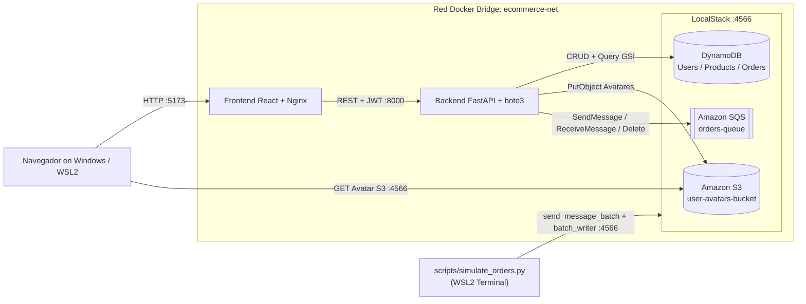

# CloudStore E-Commerce — Arquitectura Cloud-Native en WSL2 con LocalStack

Aplicación web e-commerce full-stack desplegable con **Docker Compose** dentro de **WSL2 (Windows Subsystem for Linux)**, emulando servicios de AWS (**DynamoDB**, **S3** y **SQS**) mediante **LocalStack**.

---

## 1. Stack Tecnológico

| Capa | Tecnología | Puerto | Descripción |
| :--- | :--- | :--- | :--- |
| **Frontend** | React 18 + Vite + Tailwind CSS + Nginx | `5173` | Catálogo, carrito, checkout, perfil con avatar S3 y panel de administración |
| **Backend** | Python 3.11 + FastAPI + `boto3` + PyJWT | `8000` | API REST con Swagger (`/docs`), auth JWT, subida a S3, CRUD DynamoDB y worker SQS |
| **Cloud Local** | LocalStack 3.8 (`dynamodb`, `s3`, `sqs`) | `4566` | Emulador AWS local inicializado automáticamente vía `init-aws.sh` |
| **Orquestación** | Docker & Docker Compose | Red `ecommerce-net` | Red puente compartida y healthchecks ordenados |

---

## 2. Diagrama de Arquitectura

### Diagrama Mermaid



### Diagrama ASCII

```text
+-------------------------------------------------------------------------+
|                        HOST WINDOWS / TERMINAL WSL2                     |
|                                                                         |
|   [ Navegador Web ]                     [ scripts/simulate_orders.py ]  |
|    |            |                                     |                 |
|    | :5173      | :4566 (GET Avatares S3)             | :4566 (boto3)   |
+----+------------+-------------------------------------+-----------------+
     |            |                                     |
     v            |                                     |
+-----------+     |      +----------------------------------------------+
| Frontend  |     |      |           LocalStack Container :4566         |
| React+Vite|     |      |                                              |
|  (Nginx)  |     |      |  +----------------------------------------+  |
+-----+-----+     +----->|  | S3: user-avatars-bucket (Lectura Pub.) |  |
      |                  |  +----------------------------------------+  |
      | :8000            |  +----------------------------------------+  |
      v                  |  | DynamoDB: Users, Products, Orders      |  |
+-----------+            |  +----------------------------------------+  |
|  Backend  |--(internal)|  +----------------------------------------+  |
|  FastAPI  |----------->|  | SQS: orders-queue                      |  |
|  + boto3  | :4566      |  +----------------------------------------+  |
+-----------+            +----------------------------------------------+
```

---

## 3. Estructura del Proyecto

```text
.
├── docker-compose.yml               # Orquestación LocalStack + Backend + Frontend
├── .env.example                     # Variables de entorno de referencia
├── .gitattributes                   # Fuerza finales de línea LF para scripts WSL/Linux
├── localstack/
│   └── init-aws.sh                  # Provisionamiento automático (DynamoDB, S3, SQS, seeds)
├── backend/
│   ├── Dockerfile
│   ├── requirements.txt
│   └── app/
│       ├── main.py                  # App FastAPI, CORS y /health
│       ├── config.py                # Pydantic Settings
│       ├── aws_clients.py           # Clientes boto3 (DynamoDB, S3 path-style, SQS)
│       ├── security.py              # PBKDF2-SHA256 + PyJWT + RBAC admin
│       ├── schemas.py               # Modelos Pydantic v2
│       ├── utils/dynamodb.py        # Conversión Decimal, paginación scan_all y updates
│       └── routers/
│           ├── auth.py              # Registro con avatar S3, Login JWT, /me
│           ├── users.py             # Actualización de perfil/avatar S3
│           ├── products.py          # CRUD de catálogo en DynamoDB
│           ├── orders.py            # Checkout transaccional -> DynamoDB + SQS
│           └── admin.py             # Métricas SQS y worker de procesamiento
├── frontend/
│   ├── Dockerfile                   # Build multi-stage Node 20 -> Nginx 1.27
│   ├── nginx.conf
│   ├── package.json
│   ├── public/products/*.svg        # 10 ilustraciones vectoriales del catálogo
│   └── src/
│       ├── api/client.js            # Cliente HTTP centralizado con JWT
│       ├── context/                 # AuthContext y CartContext
│       └── components/              # Navbar, Catálogo, Carrito, Perfil, AdminDashboard
├── scripts/
│   ├── requirements.txt
│   └── simulate_orders.py           # Generador de 100 pedidos con send_message_batch
└── docs/
    └── ARQUITECTURA.md              # Documentación técnica de API, tablas, SQS y S3
```

---

## 4. Guía Paso a Paso para Levantar en WSL2

### Prerrequisitos en WSL2
- **Docker Desktop** con integración WSL2 habilitada (o Docker Engine dentro de Ubuntu WSL2) y **Docker Compose v2** (`docker compose version`).
- **Python 3.10+** y **AWS CLI v2** en la terminal de WSL2 (para ejecutar el simulador y los comandos de verificación).

### Paso 1: Preparar permisos y entorno

```bash
# 1. Ubicarse en la raíz del proyecto dentro de WSL2
cd /ruta/al/proyecto

# 2. Garantizar permisos de ejecución y finales de línea LF en scripts
chmod +x localstack/init-aws.sh scripts/simulate_orders.py

# 3. (Opcional) Crear archivo .env a partir de la plantilla
cp .env.example .env
```

### Paso 2: Construir y levantar los contenedores

```bash
docker compose up --build -d
```

> **Nota:** `backend` espera automáticamente a que `localstack` complete `init-aws.sh` y pase su `healthcheck` (`service_healthy`), y `frontend` espera a que `backend` esté saludable.

### Paso 3: URLs de Acceso

- **Tienda Web (Frontend React):** http://localhost:5173
- **Documentación Interactiva API (Swagger UI):** http://localhost:8000/docs
- **Healthcheck Backend + LocalStack:** http://localhost:8000/health
- **Endpoint LocalStack:** http://localhost:4566

### Paso 4: Credenciales del Administrador Precargado

El script `localstack/init-aws.sh` crea automáticamente el usuario administrador inicial en la tabla `Users` y sube su avatar a S3:

- **Correo:** `admin@store.local`
- **Contraseña:** `Admin123!`
- **Rol:** `admin`

En el modal de **Ingresar** del frontend existe además un botón **Autocompletar** para probar rápidamente el Panel de Administración.

---

## 5. Ejecutar el Simulador de 100 Pedidos (`simulate_orders.py`)

Desde tu terminal de **WSL2**:

```bash
# Instalar boto3 si aún no lo tienes en tu entorno Python de WSL2
python3 -m pip install -r scripts/requirements.txt

# Ejecutar simulación de 100 pedidos aleatorios hacia LocalStack
python3 scripts/simulate_orders.py
```

El script realiza lo siguiente:
1. Lee los productos reales desde DynamoDB `Products`.
2. Genera **100 pedidos sintéticos** aleatorios.
3. Los envía a SQS `orders-queue` en **10 lotes de 10** usando `send_message_batch`.
4. Registra los 100 pedidos en DynamoDB `Orders` con estado `QUEUED` y su `sqs_message_id`.
5. Imprime la tabla completa de `MessageId`s, el tiempo de ejecución y el resultado final de `get_queue_attributes`.

---

## 6. Comandos de Verificación y Evidencias (Capturas de Pantalla)

Configura primero el perfil `localstack` en **AWS CLI v2** dentro de tu terminal WSL2 apuntando directamente al endpoint local (`http://localhost:4566`):

```bash
aws configure set aws_access_key_id test --profile localstack
aws configure set aws_secret_access_key test --profile localstack
aws configure set region us-east-1 --profile localstack
aws configure set output json --profile localstack
aws configure set endpoint_url http://localhost:4566 --profile localstack

export AWS_PROFILE=localstack
```

Ejecuta la prueba de humo inicial para confirmar que AWS CLI se comunica con LocalStack (debe responder `"Account": "000000000000"`):

```bash
aws sts get-caller-identity --profile localstack
```

> **Nota:** Si utilizas una versión antigua de AWS CLI (< 2.13) que no soporta `endpoint_url` en el perfil, añade `--endpoint-url=http://localhost:4566` a cada comando `aws`.

### Evidencia 1: Contenedores activos en Docker / WSL2

```bash
docker ps --format "table {{.Names}}\t{{.Image}}\t{{.Status}}\t{{.Ports}}"
docker compose ps
curl -s http://localhost:8000/health | python3 -m json.tool
```

### Evidencia 2: Tablas e ítems en DynamoDB

```bash
# Listar tablas creadas automáticamente
aws dynamodb list-tables --profile localstack

# Verificar usuario administrador precargado en tabla Users
aws dynamodb scan --profile localstack \
  --table-name Users \
  --projection-expression "user_id, username, email, #r, avatar_url" \
  --expression-attribute-names '{"#r":"role"}'

# Verificar los 10 productos precargados en tabla Products
aws dynamodb scan --profile localstack \
  --table-name Products \
  --projection-expression "product_id, #n, price, stock, category" \
  --expression-attribute-names '{"#n":"name"}'

# Contar pedidos registrados en tabla Orders
aws dynamodb scan --profile localstack \
  --table-name Orders \
  --select COUNT
```

### Evidencia 3: Bucket y archivos subidos en S3 local

```bash
# Listar buckets existentes
aws s3 ls --profile localstack

# Listar todos los avatares subidos (incluye admin-avatar.svg y los subidos desde el Frontend)
aws s3 ls s3://user-avatars-bucket --recursive --profile localstack

# Verificar política de lectura pública del bucket
aws s3api get-bucket-policy --profile localstack \
  --bucket user-avatars-bucket --output text
```

### Evidencia 4: Cola SQS y los 100 mensajes encolados tras ejecutar `simulate_orders.py`

```bash
# 1. Ejecutar simulador de 100 pedidos
python3 scripts/simulate_orders.py

# 2. Listar colas SQS activas
aws sqs list-queues --profile localstack

# 3. Consultar atributos y confirmar ~100 mensajes disponibles (ApproximateNumberOfMessages)
aws sqs get-queue-attributes --profile localstack \
  --queue-url http://localhost:4566/000000000000/orders-queue \
  --attribute-names All

# 4. Inspeccionar una muestra de mensajes en la cola (sin eliminarlos permanentemente)
aws sqs receive-message --profile localstack \
  --queue-url http://localhost:4566/000000000000/orders-queue \
  --max-number-of-messages 3 \
  --visibility-timeout 5
```

> **Tip de demostración:** Tras capturar las métricas en `100` mensajes tanto por CLI como en el **Panel Admin**, pulsa **"Procesar Toda la Cola"** en el frontend para observar cómo el worker consume los mensajes de SQS y transiciona los pedidos en DynamoDB de `QUEUED` a `PROCESSED`.

---

## 7. Solución de Problemas Frecuentes en WSL2

- **Error `exec /etc/localstack/init/ready.d/init-aws.sh: no such file or directory`:**
  Ocurre si el script tiene finales de línea Windows (`CRLF`). Conviértelo a `LF` ejecutando:
  ```bash
  sed -i 's/\r$//' localstack/init-aws.sh
  chmod +x localstack/init-aws.sh
  docker compose down -v && docker compose up --build -d
  ```
- **Reiniciar todo el estado de LocalStack desde cero:**
  ```bash
  docker compose down -v --remove-orphans
  docker compose up --build -d
  ```
- **Ver logs de inicialización de LocalStack o Backend:**
  ```bash
  docker compose logs -f localstack
  docker compose logs -f backend
  ```
